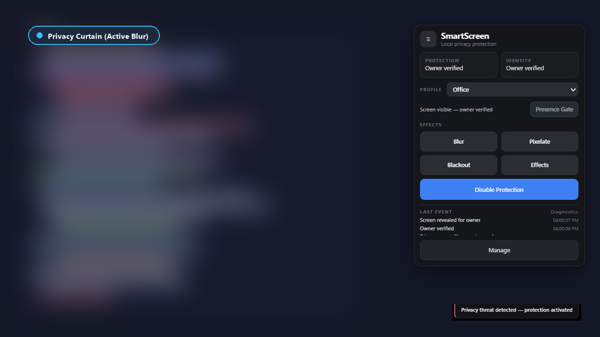
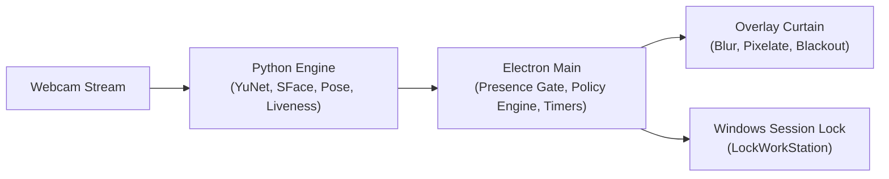

#  SmartScreen Privacy Suite

> Local-first webcam privacy screen and automated physical presence protection for Windows 10 and 11.

[](LICENSE)
[](https://github.com/roshanjhawar23/SmartScreen-Privacy-System)
[](https://github.com/roshanjhawar23/SmartScreen-Privacy-System/actions/workflows/tests.yml)
[](https://github.com/roshanjhawar23/SmartScreen-Privacy-System/releases)

---



---

## What It Does

- **Owner Recognition**: Identifies the enrolled owner via lightweight on-device face recognition (supports up to 10 trusted profiles).
- **Presence Gate**: Enforces a fail-closed visual curtain on startup and wake, revealing your desktop only after verified owner presence.
- **Walk-Away Lock**: Detects when you step away from your desk and progressively engages screen concealment before locking Windows.
- **Unknown-Viewer Escalation**: Detects shoulder-surfers or unauthorized onlookers facing your screen and conceals confidential content.
- **Multi-Monitor Curtain**: Projects synchronized, hardware-accelerated privacy overlays across all active physical and virtual displays.

## How It Works



1. **Vision Engine**: OpenCV YuNet extracts facial landmarks and bounding boxes; SFace computes 128-d embeddings to verify identity alongside head pose and liveness heuristics.
2. **Policy Engine**: Electron main coordinates the Presence Gate state machine, evaluates threat scores, and manages escalation timers.
3. **Curtain & Lock**: Transparent top-level overlays apply hardware-accelerated blur or pixelation. If an unauthorized onlooker persists or the user walks away, Windows is securely locked via native API.

## Privacy by Design

- **100% Local Inference**: Runs entirely on your CPU/GPU without external network calls, analytics, or third-party servers.
- **Encrypted Templates**: Biometric vectors are encrypted at rest using Windows DPAPI (`safeStorage`).
- **Opt-In Security Images**: Threat captures are strictly opt-in, disabled by default, and DPAPI-encrypted when enabled.
- **Zero Cloud Footprint**: Safe for air-gapped workstations and restricted enterprise environments.
- **Fail-Closed Architecture**: Camera disconnects, backend crashes, or watchdog timeouts immediately trigger screen concealment.

## Getting Started

### Installation
1. Download `SmartScreen-Privacy-Suite-Setup.exe` from the [Latest Release](https://github.com/roshanjhawar23/SmartScreen-Privacy-System/releases).
2. Run the installer.
   > **Note on Windows SmartScreen**: Because binaries are not signed with an expensive EV certificate, Windows Defender SmartScreen may display an "Unknown Publisher" warning. Click **More info** &rarr; **Run anyway**.

### First Run
1. Launch the app from the Start Menu or System Tray.
2. Complete the initial 5-sample face enrollment wizard in clear lighting.
3. Choose your default curtain effect (Blur, Pixelate, or Blackout).

### Usage
- **Control Panel**: Quick-toggle protection status, switch presets, and preview curtain styles in real time.
- **Profiles**: Switch between **Office** (standard delays), **Cafe** (aggressive escalation), and **Home** (relaxed thresholds).
- **System Tray**: Right-click the shield tray icon to pause protection, inspect activity logs, or exit.

## Configuration

Custom adjustments can be made via the UI or directly in `config/settings.json`:

| Key | Default | Description |
|---|---|---|
| `intruderDetectionEnabled` | `true` | Enable detection and escalation for unrecognized onlookers |
| `intruderFocusDelay` | `3000` | Milliseconds before an onlooker triggers screen blur |
| `intruderLockDelay` | `5000` | Milliseconds before sustained onlooker presence locks Windows |
| `noUserLockEnabled` | `true` | Automatically lock Windows session when the owner steps away |
| `noUserDetectionDelay` | `1.5` | Seconds of owner absence before walk-away grace timer begins |
| `walkAwayFocusDelay` | `3000` | Milliseconds of absence before privacy blur activates |
| `presenceGate.enabled` | `true` | Conceal screen at startup until verified owner is detected |
| `presenceGate.revealConfirmUpdates` | `3` | Consecutive owner detections required before revealing screen |
| `evidence.enabled` | `false` | Save encrypted thumbnail snapshots of detected onlookers |

## Limitations

- **Heuristic Liveness**: The software anti-spoofing layer uses texture, motion, and pose heuristics; it does not replace dedicated IR depth sensors (e.g. Windows Hello).
- **Unsigned Installer**: Binaries do not contain a commercial EV code-signing certificate.
- **Overlay Boundary**: The privacy curtain is a visual privacy barrier against human eyes, not a cryptographic kernel sandbox.
*See [SECURITY.md](SECURITY.md) for complete details on threat models and reporting procedures.*

## Development

### Prerequisites
- Windows 10 or 11 (64-bit)
- Node.js 20+
- Python 3.11+
- USB or integrated webcam

### Setup & Run
```powershell
# Clone the repository
git clone https://github.com/roshanjhawar23/SmartScreen-Privacy-System.git
cd SmartScreen-Privacy-System

# Install Node & Python dependencies
npm install
pip install -r backend/requirements.txt

# Start in development mode
npm start
```

### Running Tests
```powershell
# Run Node unit tests
npm test

# Run backend Python tests
python -m pytest backend/tests -v

# Run Playwright end-to-end tests (simulated test mode)
npm run test:e2e
```

### Building the Installer
```powershell
# Package the standalone AI binary and build NSIS installer into dist/
npm run build
```

## Project Structure

```text
SmartScreen/
├── assets/          # Application icons and system tray indicators
├── backend/         # Python computer vision service (YuNet & SFace models)
├── config/          # Tunable settings, profile presets, and enterprise policy
├── electron/        # Main process, Presence Gate state machine, FFI bindings
├── frontend/        # Glassmorphic control panel and multi-monitor overlays
└── tests/           # Unit, integration, and Playwright end-to-end test suites
```

## Releases & Changelog

See [CHANGELOG.md](CHANGELOG.md) for version release notes, migration guides, and roadmap milestones.

## License & Acknowledgements

- Licensed under the [MIT License](LICENSE).
- Computer vision detection and recognition powered by OpenCV Zoo [YuNet](https://github.com/opencv/opencv_zoo/tree/main/models/face_detection_yunet) and [SFace](https://github.com/opencv/opencv_zoo/tree/main/models/face_recognition_sface).
